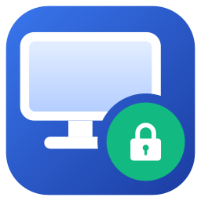

# safe-rdp

<p align="center"></p>

[English](README.md) | 한국어

Tailscale 위에서 쓰는 작고 감사(audit) 가능한 원격 데스크톱. **Windows와 Linux** 모두 호스트·뷰어로 동작합니다.

- **Rust 단일 실행 파일**, 서드파티 크레이트 없음. Windows는 `windows-sys`(Microsoft 공식 Win32 바인딩)만 쓰고
  C 런타임을 실행 파일에 포함해 Visual C++ 재배포 패키지가 필요 없음.
  Linux는 표준 라이브러리 + 실행 시 `dlopen`하는 시스템 OpenSSL(libcrypto)만 사용 (libX11/xcb도 링크하지 않고 X11 프로토콜을 직접 말함)
- 암호는 OS 구현만 사용 (Windows CNG, Linux OpenSSL 3). 직접 구현한 암호 코드는 HKDF와 키 지문(HMAC 몇 번 호출)뿐
- 화면 데이터를 **디스크에 쓰지 않음** (비트맵 캐시 없음, 프레임 버퍼는 RAM에 고정 후 종료 시 소거)

## 왜 만들었나 — 기본 RDP의 비트맵 캐시

`mstsc.exe`는 기본값으로 *영구 비트맵 캐싱*을 켜고, 원격 화면 타일을
`%LOCALAPPDATA%\Microsoft\Terminal Server Client\Cache\` (`bcache*.bmc`, `Cache*.bin`)에 저장합니다.
이 파일들은 세션이 끝난 뒤에도 남고, 공개 포렌식 도구로 원격 화면 조각을 복원할 수 있습니다.
safe-rdp는 이런 영속 데이터를 만들지 않도록 설계했습니다.

## 빠른 시작 (Windows, GUI)

1. 빌드: 저장소 폴더에서 `cargo build --release`(직접 `RUSTFLAGS`를 지정한다면 `-C target-feature=+crt-static` 유지) →
   `target\release\safe-rdp.exe`를 양쪽 PC의, 본인이나 관리자만 쓸 수 있고 내려받은 파일이 들어가지 않는 폴더에 복사.
   다운로드 폴더나 공유 폴더, 받은 파일이 들어가는 `다운로드\safe-rdp`는 안 됩니다(그곳에서 실행하면 safe-rdp가 파일 받기를 거부)
2. `safe-rdp.exe`를 더블클릭하면 런처 창이 열립니다 (`safe-rdp gui`와 같음)
3. **보안 키** 탭: 한쪽 PC에서 *새 키 만들기* → *복사*, 다른 PC의 보안 키 탭에서 *가져오기*에 붙여넣기
   (복사한 키는 클립보드 기록·클라우드 동기화에서 제외되고, Windows가 제외를 받아들이지 않으면 아예 복사되지 않으며, 60초 뒤
   자동으로 지워집니다. 다른 프로그램이 클립보드를 잡고 있으면 1초마다 다시 시도).
   여기서 키를 바꾸거나 삭제하면 런처의 공유가 새 키로 다시 시작되거나 중지되고 접속한 사람의 연결이 끊어집니다.
   공유 중에 터미널에서 바꾼 키(`keygen --force`, `key import`, `key forget`)도 2초 안팎에 반영됩니다
4. 원격 PC: **이 PC 공유** 탭에서 *공유 시작*. 허용할 기능(제어, 클립보드, 파일, 소리, 화면 가리기)을 고릅니다
   (처음에는 제어만 켜져 있음)
5. 로컬 PC: **접속하기** 탭의 Tailscale 기기 목록에서 원격 PC를 더블클릭. 명령줄과 마찬가지로 *클립보드 공유*와 *소리 재생*은
   직접 켜야 합니다(이전 버전이 저장한 설정에서도 한 번 꺼짐). *화질*은 호스트가 정하는 *기본*에서 시작합니다

뷰어 창 위쪽의 **연결 바**에서 모니터·화질·배율 전환, 클립보드, 파일 보내기/받기, 소리, 화면 가리기,
전체 화면, 연결 끊기를 할 수 있습니다. 전체 화면에서는 화면 맨 위 가운데에 마우스를 대면 나타납니다.
호스트가 허용하지 않은 기능은 버튼이 숨겨지고, 연결이 끊기면 자동으로 다시 연결합니다
(1, 2, 4, 8, 16, 30초 간격, 2분 후 포기. 키가 틀리면 즉시 중단).
자동 재연결은 자기 세션만 되찾습니다. 그사이 다른 뷰어가 접속해 있으면 호스트가 거절하고
("another viewer is using this host") 뷰어는 재시도를 멈춥니다(호스트가 핑에 한 번도 답하기 전에 끊겼다면 호스트가 이 뷰어를
아직 모를 수 있으므로 2분 동안 계속 시도). 직접 접속하면 지금 접속한 뷰어를 여전히 대체합니다.
이 규칙에는 이 버전의 뷰어와 호스트가 필요합니다. 어느 한쪽이라도 이전 버전이면 자동 재연결도 예전처럼 지금 접속한 뷰어를 대체합니다.

## 빠른 시작 (명령줄, Windows/Linux 공통)

```bash
safe-rdp keygen                # 키 생성 (한 번 출력되고 이 계정 전용으로 저장)
safe-rdp key import            # 다른 PC에서: 프롬프트에 붙여넣기 (명령줄 인자로는 받지 않음.
                               # 여기서 Ctrl+C를 눌러도 터미널 에코는 다시 켜짐)
safe-rdp host                  # 원격 PC: 이 PC의 Tailscale IP에만 바인딩 (Tailscale을 기다림)
safe-rdp devices               # tailnet 기기 목록
safe-rdp connect 원격PC이름     # MagicDNS 이름, Tailscale IP, host:port 모두 가능
```

| 단축키 (뷰어) | 동작 |
|---|---|
| `Ctrl+Alt+Enter` | 전체 화면 전환 |
| `Ctrl+Alt+End` | 원격에 Ctrl+Alt+Del 전송 (Windows 서비스 모드 + `--enable-sas`) |

창 모드에서는 Win 키, Alt+Tab, Alt+Esc, Ctrl+Esc가 그때 누르고 있던 Ctrl/Alt/Shift와 함께 로컬에 남으므로(mstsc 기본 동작과 동일)
Ctrl+Shift+Esc, Alt+Shift+Tab, Ctrl+Win+화살표도 로컬에서 동작합니다(Windows 원격에는 Alt나 Win 단독 입력으로 보이지 않습니다).
전체 화면에서는 뷰어에 포커스가 있는 동안 모든 키가 원격으로 갑니다(다른 창이 포커스를 가져가면 Linux 뷰어는 다시 포커스를 받을
때까지 키보드를 놓아 줍니다. 창 관리자가 있으면 마우스 포인터가 뷰어 위에 있는 것만으로는 포커스로 치지 않습니다). 한/영, 한자
키는 원격 IME로 그대로 전달되고, AltGr는 오른쪽 Alt로 전달되어 원격의 키보드 배열이 입력할 문자를 정합니다. 뷰어 PC의 다른
프로그램이 유니코드 문자로 입력하는 텍스트(일부 비밀번호 관리자의 자동 입력, 이모지 패널, 터치 키보드)는 키 입력만 전달하므로
원격에 가지 않습니다. 클립보드를 쓰세요.

## Linux

필요한 것: OpenSSL 3 런타임(`libssl3`, Ubuntu/Debian/Fedora 기본 설치), 호스트는 X11(XTEST, XFIXES, 가능하면 MIT-SHM),
소리는 PipeWire의 `pw-record`/`pw-play`. 지원: 64비트 x86_64, aarch64(예: 64비트 Raspberry Pi OS), riscv64의 glibc 환경,
또는 시스템의 libcrypto를 쓰는 동적 링크 musl 빌드(`-C target-feature=-crt-static`). Rust의 musl 기본값인 정적 빌드는 libcrypto를
로드할 수 없습니다. 다른 아키텍처(32비트 ARM·x86, x32, powerpc, mips, s390x, loongarch) 빌드는 시스템 상수를 확인하기
전까지 컴파일 오류로 멈춥니다.

- **데스크톱이 있는 Linux**: X11 세션에서 `safe-rdp host`. Wayland 세션(Ubuntu 기본 GNOME)은 Xwayland 창만
  캡처·입력할 수 있으므로 로그인 화면에서 "Ubuntu on Xorg"를 고르거나 아래 가상 화면을 쓰세요.
- **서버(모니터 없음)**: 가상 화면을 만들어 그 안의 프로그램을 공유합니다.

  ```bash
  safe-rdp host --virtual 1920x1080                      # 기본: 화면을 채우는 터미널
  safe-rdp host --virtual 1600x900 --session "xterm"     # 원하는 프로그램
  ```

  Xvfb는 TCP를 끈 채로 무작위 쿠키로 띄웁니다. Xvfb와 호스트는 이 쿠키를 이름 없는 메모리 파일(Xvfb에는 파일 디스크립터로 넘김)에서
  읽으므로, 파일 경로에 무슨 일이 생겨도(tmp 정리 도구, 다른 사용자가 디렉터리를 다시 만드는 경우) 지워지거나 바뀌지 않습니다.
  Xvfb가 쿠키 없는 클라이언트를 받아들이면 시작이 실패합니다. 세션 안의 프로그램은 `$XDG_RUNTIME_DIR`(절대 경로이고 사용자 본인 소유의
  비공개 디렉터리일 때만), 아니면 임시 디렉터리(심볼릭 링크가 아니고 소유자가 root나 본인이며, 남이 쓸 수 있으면 sticky여야 함)
  아래의 0700 디렉터리에 있는 0600 사본을 쓰며, 호스트가 도는 동안 tmp 정리 도구가 지우지
  못하게 잠가 둡니다. 호스트가 끝나면(Ctrl+C, SIGTERM, 비정상 종료 포함) Xvfb와 세션도 함께 종료됩니다.
  반대로 세션 프로그램이 끝나면(터미널에서 `exit`) 호스트도 멈춥니다. 그래서 `--session` 명령은
  백그라운드로 띄우지 말고 앞에서 계속 실행되게 하세요(`exec 프로그램`).
  같은 서버의 다른 사용자가 가상 화면을 가로채지 못하도록, 접속하는 X 서버가 우리가 띄운 Xvfb 프로세스인지
  매번 `SO_PEERCRED`로 확인하고 `/tmp/.X11-unix`의 소유자도 검사합니다.
- **뷰어**: `safe-rdp connect`가 X11 창을 엽니다(연결 바는 없고 단축키·명령줄 옵션으로 조작).
  스스로 다시 연결하지 않으며, X11은 창을 스크린샷·녹화에서 숨길 수 없습니다(시작할 때 경고).
- 키는 `~/.config/safe-rdp/key`(디렉터리 0700, 파일 0600. 상대 경로 `$XDG_CONFIG_HOME`은 무시)에 저장됩니다. 심볼릭 링크이거나
  다른 사용자 소유이거나 남이 읽을 수 있는 키 파일은 거부하고, 남이 쓸 수 있는 폴더에는 저장하지 않습니다. `key forget`은 파일을
  제자리에서 덮어쓴 뒤 지웁니다. Windows의 DPAPI 같은 OS 암호화가 없으므로 디스크 암호화를 권장합니다.

Linux 호스트에는 화면 가리기, Ctrl+Alt+Del, "복사한 파일 받기"가 없습니다(업로드는 됨).

## 기능

| 기능 | 설명 |
|---|---|
| 화질 | `균형`(호스트를 `--quality`로 띄우지 않았을 때의 기본): 사진·동영상처럼 복잡한 타일만 손실 압축(JPEG 방식, q80), 글자·UI는 무손실, 변화가 멈추면 0.3초 뒤 무손실로 다시 보냄(화면의 다른 부분이 계속 바뀌는 중에도). `저대역폭`: q50, 1.5초 뒤 보정. `무손실`(바꾸면 손실 타일을 바로 정확하게 다시 보냄) |
| 배율 | 100/50/33/25% (`--downscale`), 4K 호스트를 노트북에서 보거나 느린 회선일 때 |
| 모니터 | 세션 중 모니터 전환, `all`은 모든 모니터를 한 화면으로(DXGI, 여러 GPU 포함. 약 6600만 화소(8K 화면 2개)를 넘으면 호스트가 더 축소). 회전·HDR 모니터 지원 |
| 클립보드 | 텍스트, 양쪽 모두 켜야 동작. 원격에서 온 텍스트는 Win+V 기록·클라우드 클립보드에서 제외(Windows가 제외를 받아들이지 않으면 클립보드에 넣지 않음) |
| 파일 | 뷰어 창에 끌어다 놓거나 *파일 보내기* → 호스트의 `다운로드\safe-rdp`. *복사한 파일 받기*: 호스트에서 탐색기로 복사(Ctrl+C)한 파일을 뷰어의 `다운로드\safe-rdp`로 |
| 소리 | 호스트의 시스템 소리(WASAPI 루프백 / PipeWire), IMA ADPCM 약 390 kbit/s, 지연 약 90–130 ms |
| 화면 가리기 | 원격 사용 중 호스트 모니터를 검게 가리고 호스트의 로컬 키보드·마우스를 막음 (Windows 호스트) |

파일 전송 안전장치:
- 이름은 경로가 아닌 단일 파일명만 허용. 끝이 `.`/공백인 이름, `CON`·`NUL` 같은 장치 이름, 확장자를 속이는
  양방향(RLO 등) 문자는 거부
- 무작위 이름의 `.srdp-*.part` 파일에 받은 뒤(Linux에서는 점으로 시작해 숨김 파일, Windows에서는 보이지만 받는 동안 다른
  프로그램이 쓰거나 지울 수 없음) 크기와 SHA-256이 맞을 때만 원래 이름을 붙임. 이미 있는 것은 무엇도 대체하지 않음: 파일·폴더,
  아무것도 가리키지 않는 심볼릭 링크, 같은 순간 끝난 같은 이름의 다른 업로드도(`이름 (1).ext`)
- Windows에서는 받기 시작할 때부터 *인터넷에서 받은 파일* 표시(Mark of the Web)를 붙여 SmartScreen·Office 보호된
  보기가 적용됨. 표시를 붙일 수 없는 드라이브(FAT/exFAT)에서는 전송을 거부
- 뷰어는 *복사한 파일 받기*를 누른 뒤에만 파일을 받음(클릭당 최대 1000개, 전송이 30초 넘게 멈추면 요청 만료.
  만료 뒤 도착한 파일이 있으면 알려 줌). 복사한 파일이 네트워크 경로(`\\server\...`, 네트워크 드라이브)에 있으면 보내지 않음.
  파일을 연 뒤에도 다시 확인하므로, 그사이 폴더가 네트워크 공유로 바뀐 파일도 거부
- 받는 파일은 그 볼륨의 1%(256 MiB–2 GiB, 서비스 전용 폴더는 5%, 아래 참고)를 비워 둬야 하며, 아직 받는 중인 다른 전송도 함께 셈.
  64 MiB마다 다시 확인하고, 그사이 디스크가 차면 전송을 멈춤. 중단된 부분 파일은 지움(Windows에서는 경로가 아니라 열린 핸들로)
- 받은 파일은 safe-rdp가 실행 중인 폴더(Windows가 DLL을 가장 먼저 찾는 곳)에는 저장하지 않음. 그런 전송은
  safe-rdp.exe를 다른 곳으로 옮기라는 메시지와 함께 거부
- 서비스 모드에서 *복사한 파일 받기*와 `--transfer-dir` 폴더로의 업로드는 SYSTEM이 아니라 콘솔에 로그인한 사용자 권한을 쓰므로
  둘 다 로그인 화면에서는 동작하지 않음(기본 업로드 폴더는 서비스 모드 참고)

화면 가리기는 뷰어가 보낸 입력만 통과시킵니다(이벤트마다 한 번만 쓰이는 무작위 표식). 화면 가리기를 켜기 전에 다른
프로그램이 엿본 표식은 무효이고, 한 호스트 프로세스에서 동시에 하나만 켜집니다.
Windows가 뷰어의 입력에 덧붙이는 키(AltGr가 있는 배열에서 AltGr의 왼쪽 Ctrl, Num Lock이 켜져 있을 때 숫자 키패드 키 앞뒤로
떼었다 다시 누르는 Shift)는 호스트가 그 키를 입력하는 동안에만 통과하므로 AltGr와 Shift+숫자 키패드도 평소처럼 동작합니다.
한계: Ctrl+Alt+Del과 Win+L은 항상 Windows가 처리하므로 원격 PC 앞의 사람은 언제든 잠글 수 있습니다.
보안 데스크톱(UAC·잠금 화면), 시작 메뉴·알림 같은 셸 화면은 가림막 위로 올라올 수 있고, 마우스 포인터는 보입니다.
관리자 권한 창이 포커스를 가진 동안은 일반 권한 호스트가 로컬 입력을 막지 못합니다.

## 서비스 모드 (Windows: 잠금 화면 / 로그인 화면 / UAC)

`safe-rdp host`는 로그인된 사용자 세션 안에서 일반 권한으로 돌기 때문에
잠금 화면, UAC 보안 데스크톱, 관리자 권한 창에는 접근할 수 없습니다. 필요하면 서비스로 설치하세요
(런처의 *이 PC 공유* 탭 하단 버튼, 또는 관리자 터미널에서):

```bash
safe-rdp service install --enable-sas
safe-rdp service status        # 상태와 서비스 키의 지문: 이 사용자의 키인지
safe-rdp service rekey         # 이 계정의 현재 키를 서비스에 넣음. 다른 옵션은 그대로
safe-rdp service uninstall
```

설치 시 하는 일:

1. 실행 파일을 `C:\Program Files\safe-rdp\`로 복사 (관리자만 교체 가능한 위치에서 SYSTEM으로 실행. 일반 사용자도 그 사본을 읽고
   실행할 수 있음). 이 단계가 먼저이므로 복사가 실패하면(설치된 사본이 열려 있는 경우 등) 키와 지문은 그대로이고 이전 서비스를 다시 시작
2. 키를 `%ProgramData%\safe-rdp\service.key`에 저장 — 폴더/파일 ACL은 SYSTEM·Administrators 전용, 내용은 DPAPI(머신 범위) 암호화
3. `SafeRdpHost` 서비스 등록(자동 시작, 실패 시 재시작), 키 지문을
   `HKLM\SYSTEM\CurrentControlSet\Services\SafeRdpHost\Parameters\KeyFingerprint`에 기록(사용자는 읽기만, 변경은 관리자만 가능, 서비스와 함께 삭제)
4. 방화벽: 이 프로그램의 TCP 47300(또는 `--port`로 지정한 포트) 인바운드를 **원격 IP 100.64.0.0/10, fd7a:115c:a1e0::/48에서만** 허용
   (`netsh.exe`는 System32의 전체 경로로 실행)
5. `--enable-sas`를 준 경우에만 `SoftwareSASGeneration=1` 정책 설정 (서비스가 Ctrl+Alt+Del을 생성할 수 있게)

서비스는 설치할 때 받은 키를 계속 쓰고, 바꾸기 전까지 그 키를 받아들입니다. 키를 바꾼 뒤에는(`keygen --force`, `key import`,
보안 키 탭) 관리자 권한으로 `safe-rdp service rekey`를 실행하세요. 실행한 계정에 저장된 키를 서비스에 넣고 다시 시작하며,
명령줄·방화벽 규칙·옵션은 그대로 둡니다. `key forget` 뒤에는 `service uninstall`을 실행하세요. 키 명령과 `service status`는
서비스가 어떤 키를 가졌는지 알려 주고 실행할 명령을 그대로 출력합니다. 지문이 기록되지 않은 서비스는 이전 버전의 safe-rdp가
설치했을 수 있고, 그렇다면 `rekey`가 손대지 않는 그 이전 프로그램으로 돕니다. 그래서 이런 서비스에는 설치할 때 쓴 옵션과 함께
`service install --expect-key <지문>`을 안내하고, `rekey`도 그 점을 알려 줍니다.
런처는 키를 바꾸자마자 업데이트를 제안하고, 그동안 서비스가 다른 키를 가졌다고 확인되면 설치 버튼에 *키 업데이트*(rekey)를
보여 줍니다. 키를 확인할 수 없는 서비스는 *키 확인 불가*로 표시하고(*이 PC 공유* 탭에 이유 표시) 버튼은 *다시 설치*로 두며,
키를 바꾼 뒤의 제안도 다시 설치입니다(*다시 설치*는 터미널에서 지정한 옵션이 사라진다고 경고). 첫 인자로 `--expect-key <지문>`을
주면 `install`과 `rekey`는 실행한 계정의 키 지문이 다를 때 아무것도 바꾸지 않고 거부합니다(종료 코드 3). UAC에서는 권한을 승인한
계정의 키가 서비스로 가므로 런처는 항상 이 인자를 넘깁니다. 두 명령 모두 설치된 서비스가 20초 안에 멈추지 않으면 아무것도 바꾸지
않고(종료 코드 4), 서비스에 새 키와 지문을 넣었지만 시작하지 못하면 종료 코드 5로 끝납니다.

`%ProgramData%\safe-rdp`는 소유자가 SYSTEM/Administrators이고 관리자 전용 ACL이어야 합니다. 일반 사용자가 미리 만들어 둔
폴더라면 설치를 거부하니(키 탈취·바꿔치기 방지) 그 폴더를 지운 뒤 다시 설치하세요. 서비스와 에이전트도 시작할 때마다
같은 검사를 하고, 서비스는 에이전트를 끝낼 때 SYSTEM 전용 이벤트로 먼저 정상 종료(눌린 키 해제)를 요청합니다.
탐색기에서 이 폴더를 열 때 나오는 "계속" 버튼은 읽기 권한만 더하므로 괜찮지만, 다른 계정에 쓰기 권한을 주면 서비스가
시작을 거부합니다. 그때는 `safe-rdp service status`가 이유를 보여 주고, `service install`을 다시 하면 권한이 복구됩니다.
`--files`를 켜고 `--transfer-dir`를 주지 않으면 서비스는 업로드를 `%ProgramData%\safe-rdp\incoming`(관리자 전용)에 저장하며,
로그인 화면·잠금 화면에서도 받습니다. 이 폴더는 관리자가 비울 때까지 모두 합쳐 최대 1000개 / 64 GiB까지 받고(비정상 종료 등으로 24시간
넘게 남은 부분 파일은 세기 전에 지움), 그 볼륨에 5%
(1–16 GiB)가 남을 때만 파일을 받습니다. `--transfer-dir <전체 경로>`를 주면(`service install`은 상대 경로를 거부) 업로드는
콘솔에 로그인한 사용자로 저장되므로, 누군가 로그인해 있고 그 사용자가 폴더에 파일을 만들 수 있을 때만 됩니다.
*복사한 파일 받기*는 항상 로그인한 사용자가 있어야 합니다. 서비스(세션 0)는 활성 콘솔 세션에 SYSTEM 토큰으로 *에이전트*를 띄우고,
에이전트는 입력 데스크톱(Default ↔ Winlogon)을 따라가며 캡처/입력을 합니다.
로그: `%ProgramData%\safe-rdp\service.log`, `host.log` (IP와 이벤트만 기록, 화면·키 입력·파일 내용은 기록하지 않음.
4 MiB가 넘으면 `.old`로 넘기고 새로 시작하므로 디스크를 채우지 않음)

## 옵션

```
호스트 (host / service install):
  --bind <ip>              바인딩 주소 (기본: 이 PC의 Tailscale IPv4, 생길 때까지 기다림)
  --port <n>               TCP 포트 (기본 47300)
  --allow <ip>[,<ip>...]   이 주소들만 허용 (기본: 모든 Tailscale 피어. 빈 목록·빈 항목은 오류이고,
                           ::ffff:a.b.c.d는 여기와 --bind에서 a.b.c.d로 취급)
  --allow-non-tailscale    Tailscale 대역 밖 바인딩/피어 허용 (비권장)
  --monitor <n|all>        처음 보여 줄 모니터 (1 = 주 모니터(기본), `safe-rdp monitors`로 확인),
                           뷰어는 이 PC의 다른 모니터로 바꿀 수 있음
  --fps <n>                최대 프레임레이트 (기본 30)
  --quality <q>            화질을 지정하지 않은 뷰어의 기본값: lossless | balanced | low
  --clipboard              텍스트 클립보드 공유 허용 (뷰어도 켜야 동작)
  --files                  파일 전송 허용 (업로드, 복사한 파일 받기)
  --transfer-dir <path>    업로드 저장 위치 (서비스: 전체 경로, 콘솔에 로그인한 사용자로 저장)
  --audio                  뷰어가 이 PC의 소리를 듣도록 허용
  --privacy                뷰어가 이 PC 화면을 가리고 로컬 입력을 막도록 허용
  --view-only              키보드/마우스 입력 무시 (파일·화면 가리기도 불가)
  --virtual <WxH>          (Linux) 새 가상 X 화면(Xvfb)에서 실행
  --session <cmd>          (Linux, --virtual과 함께) 그 안에서 실행할 프로그램
  --key-file <path>        키 저장소 대신 텍스트 파일에서 키 읽기 (service install에서는 불가)

뷰어 (connect):
  --fullscreen             전체 화면으로 시작
  --clipboard              텍스트 클립보드 공유 (호스트도 허용해야 함)
  --view-only              입력·클립보드 텍스트·파일을 보내지 않고 화면 가리기도 요청하지 않음
                           (호스트의 클립보드는 받음)
  --downscale <2|3|4>      1/N 해상도로 받기
  --quality <q>            lossless | balanced | low (기본: 호스트의 --quality, 없으면 balanced)
  --monitor <n|all>        볼 호스트 모니터 (1 = 주 모니터)
  --audio                  호스트 소리 재생
  --privacy                연결 중 호스트 화면을 가리고 로컬 입력 차단
  --allow-capture          (Windows) 로컬 캡처 도구가 뷰어 창을 찍는 것을 허용 (기본은 차단;
                           Linux/X11 뷰어는 막을 수 없음)
  --key-file <path>        텍스트 파일에서 키 읽기
```

클립보드·파일·소리·화면 가리기는 모두 **호스트가 명시적으로 허용해야** 켜집니다(기본 꺼짐).
뷰어의 클립보드와 소리도 직접 켜야 합니다.
기타: `safe-rdp monitors`, `safe-rdp bench`(캡처/인코딩 속도), `safe-rdp key show|forget`,
`safe-rdp probe`(화면 없이 접속해 지연·대역폭·입력·설정·파일 전송을 시험하는 진단 도구. `--seconds`는 최대 86400이고,
`--pull`은 받은 파일이 모두 온전히 도착하지 않으면 오류로 끝남).
옵션을 받지 않는 명령(`gui`, `devices`, `monitors`, `key show|forget`, `service status|uninstall`)은 인자가 더 있으면 거부하므로
`safe-rdp key forget --help`는 아무것도 바꾸지 않습니다.
`keygen --force`, `key import`, `key forget` 뒤에도 이미 실행 중인 `safe-rdp host`는 다시 시작할 때까지 이전 키를 씁니다.

## 보안 설계

### 전송 계층 (Tailscale 암호화 위에 한 겹 더)

Tailscale(WireGuard)이 이미 암호화하지만, 같은 tailnet의 다른 기기·ACL 실수·Tailscale 계정 탈취를
가정해 **애플리케이션 계층에서 독립적으로 인증·암호화**합니다.

```
C -> S  ClientHello = "SRDP" | ver(2) | nonce_c[32] | ECDH_P256_pub_c[64]
S -> C  ServerHello = "SRDP" | ver(2) | nonce_s[32] | ECDH_P256_pub_s[64] | server_confirm[32]
C -> S  client_confirm[32]

th  = SHA-256("safe-rdp/2 transcript" | ClientHello | ServerHello(confirm 제외))
prk = HKDF-Extract(salt = PSK, ikm = ECDH 공유 비밀(X 좌표, 빅엔디언))
okm = HKDF-Expand(prk, "safe-rdp/2 keys" | th, 128)
    = key_c2s | key_s2c | server_confirm | client_confirm
```

- **상호 인증**: 256비트 무작위 PSK를 모르면 confirm 값을 만들 수 없음. 서버가 먼저 증명하므로
  가짜 서버에게 클라이언트는 아무것도 드러내지 않음.
- **전방 비밀성**: 매 세션 임시 ECDH 키. PSK가 나중에 유출돼도 녹화된 과거 트래픽은 복호화 불가.
- **오프라인 사전 공격 불가**: 키는 비밀번호가 아니라 `keygen`으로 만든 32바이트 난수만 허용.
- **키 지문**: 키 저장소 밖에 저장되는 키 파생 값은 지문(서비스용, 위 참고) 하나뿐이며, HMAC-SHA256(키, "safe-rdp/1 key fingerprint")의
  앞 8바이트. 256비트 키에 대해 아무것도 드러내지 않고, 이 레이블은 핸드셰이크가 같은 키로 HMAC에 넣는 32바이트 ECDH 비밀과 같을 수 없음.
- **레코드**: AES-256-GCM, 방향별 키, 64비트 카운터 논스(재전송·재정렬·변조 즉시 세션 종료),
  길이 필드도 AAD로 인증, 레코드 최대 32 MiB. 레코드를 온전히 보내지 못하면 세션을 끝내므로 그 뒤로는 아무것도 보내지 않음
  (Windows 뷰어는 다시 연결).
- Windows(CNG)와 Linux(OpenSSL)가 같은 바이트를 만드는지 NIST CAVS 벡터와 고정 AES-GCM 벡터로 양쪽에서 검증.

### 노출 면 최소화

- Tailscale 인터페이스에만 바인딩: 기본값은 Tailscale 자체 어댑터(Windows: *Tailscale Tunnel* 어댑터, Linux: `tailscale0`)에 있거나
  `tailscale status`가 이 기기의 것이라고 알려 주는 주소. 100.64.0.0/10 대역이기만 한 주소(모바일 모뎀·5G/위성 게이트웨이의
  캐리어급 NAT, 다른 VPN)는 무시하고 한 번만 기록한 뒤 Tailscale을 계속 기다림. 피어 주소가 Tailscale 대역이 아니면 핸드셰이크 전에 끊음
- Windows에서 safe-rdp.exe가 시작할 때 가져오는 DLL은 Windows가 자체 사본에서 (그 DLL이 가져오는 DLL까지) 매핑하는
  KnownDLL뿐이고, 그 밖에 쓰는 DLL은 처음 쓸 때 System32에서만 찾아 로드함. 그래서 옆에 놓인 `dxgi.dll`이나 `sspicli.dll`
  (다운로드·공유 폴더·받은 파일 사이)은 로드되지 않음. 예외는 Windows의 side-by-side 방식: 옆에 `safe-rdp.exe.config`와
  어셈블리 매니페스트를 두면 safe-rdp.exe가 요청하는 공용 컨트롤을 다른 것으로 바꿀 수 있고, 이를 통해 그 폴더의 어떤 DLL이든
  로드하게 할 수 있음. 그러므로 safe-rdp.exe는 본인이나 관리자만 쓸 수 있는 곳에 둘 것
- 인증 전 파싱은 고정 길이 101바이트 하나뿐. 핸드셰이크와 뷰어의 첫 메시지(hello, 최대 13바이트)는 접속 시점부터
  10초 마감 하나를 함께 씀(한 바이트씩 흘려 보내며 버티기 불가). 뷰어도 핸드셰이크와 호스트의 첫 메시지(최대 4097바이트)에
  20초 마감 하나를 씀. 뷰어가 받아들여지거나 거절되기 전까지(세션을 넘겨받는 뷰어는 이전 세션이 정리될 때까지, 최대 5초 더) 동시 연결은
  전체 8개·주소당 2개·(Tailscale 밖 IPv6는) /64당 4개, 실패한 주소는 1초 지연,
  인증 전 로그는 분당 몇 줄로 제한
- 인증 후에도 모든 메시지·타일 좌표·압축 해제 크기를 검증(한 메시지가 화면의 2배 넘게 그리게 하는 것도 거부).
  압축 해제(XPRESS Huffman, 손실 코덱, ADPCM)는 모두 메모리 안전한 Rust로 구현했고 잘못된 입력 수만 건으로 퍼징 테스트.
  설정 변경(화질·배율·모니터)은 호스트에서 최대 16개까지만 대기하고, 더 보내는 뷰어는 기다리게 하므로 호스트 메모리를 늘리거나
  화면 갱신을 붙잡아 둘 수 없음
- 상대가 보낸 이름·알림 문구는 제어/양방향 문자를 걸러서 표시·기록. 악의적인 호스트도 뷰어의 소리·화면 가리기를
  사용자 몰래 켜거나, 요청하지 않은 파일을 보내거나, 알림·프레임·커서 변경·설정 변경을 쏟아내 뷰어를 멈추게 할 수 없음
- 호스트가 뷰어의 메모리를 바닥내거나 창을 붙잡아 둘 수도 없음: 프레임 확인(ack)은 최신 것 하나만 대기, 호스트가 읽지 않아
  메시지 4096개나 클립보드 텍스트 8 MiB가 쌓이면 세션 종료(Windows 뷰어는 다시 연결). 새 클립보드 텍스트는 그 뒤에 키 입력이나
  클릭이 대기열에 들어가지 않았다면 대기 중인 텍스트를 대체하므로, 느린 회선에서 계속 복사해도 이 한도에 닿지 않음. 타일 디코딩은
  창이 쓰는 잠금 밖에서 하고 초당 화면 480장 분량을 넘으면(1초 분량 여유 이상) 세션 종료, 크기 변경은 연속 8번 뒤 초당 1번,
  프레임·커서 알림은 합쳐서 그 사이 입력·다시 그리기가 차례를 받음. Windows 뷰어는 한 번 그릴 때 4K 화면 한 장 분량까지만
  부드럽게 축소·확대하고, 그보다 큰 그림은 움직이는 동안 부드럽게 하지 않고 그렸다가 멈추고 약 150 ms 뒤에 부드럽게 다시 그리므로,
  어떤 호스트도 한 번 그리는 비용을 4K 화면보다 크게 만들 수 없음
- view-only 세션(호스트나 뷰어의 `--view-only`)은 입력뿐 아니라 호스트 클립보드 변경·파일 전송·화면 가리기도 불가
- 새 뷰어가 인증되면 기존 세션을 넘겨받음(한 번에 한 세션). 밀려난 뷰어는 이유("another viewer connected to this host")를 듣고
  다시 연결하지 않으며, 호스트는 그 알림을 읽을 때까지 연결을 열어 둠(최대 20초, 동시에 4개까지). 새 뷰어는 이를 기다리지 않음
- 끊길 때 눌려 있던 키/버튼을 모두 떼고 화면 가리기를 해제. Windows 호스트에서 입력 데스크톱에 닿지 못한 키 떼기(일반 호스트가
  잠금 화면·UAC 창에 있을 때)는 세션 중에도, 세션이 끝난 뒤 최대 10분 동안에도 0.5초마다 다시 시도하고, 그래도 남은 것은 다음
  세션이 넘겨받아 뷰어가 입력을 보내든 말든 세션이 이어지는 동안 계속 시도함. 아직 떼지 못한 상태에서 호스트가 멈추면 더는 뗄 수 없음
- 호스트를 Ctrl+C/SIGTERM으로 멈춰도 같은 정리 과정을 거치며, 아직 정리 중인 밀려난 세션과 그 알림을 보여 주는 중인 연결도 끝냄

### 화면 데이터 잔존 방지

| 위험 | 대응 |
|---|---|
| 디스크 비트맵 캐시 | 없음. 화면 데이터를 파일로 쓰는 코드 자체가 없음 (진단용 `probe --snapshot`만 예외) |
| 스왑 | 프레임 버퍼를 `VirtualLock`/`mlock`으로 RAM에 고정, Linux는 코어 덤프에서도 제외. 뷰어의 세션 수신 스레드는 따로 고정된 사본에 디코딩하므로 뷰어는 원격 화면의 약 2배(최대 2 × 256 MiB, 원격 화면 크기가 바뀌는 동안 Linux 뷰어는 잠깐 사본 하나를 더 가짐)를 씀 |
| 종료 후 메모리 잔존 | 프레임 버퍼·평문 레코드 버퍼·키를 해제 전에 0으로 덮어씀 |
| 다른 프로세스의 메모리 읽기 | Linux: `PR_SET_DUMPABLE=0`(같은 사용자의 ptrace·/proc/pid/mem 차단) |
| 로컬 스크린샷/녹화 | Windows: 뷰어 창에 `WDA_EXCLUDEFROMCAPTURE` (캡처 시 검게 보임, `--allow-capture`로 해제). Linux(X11): 불가능, 뷰어가 시작할 때 경고 |
| 키 저장 | Windows: DPAPI(사용자 범위), 서비스는 ACL + DPAPI(머신 범위). Linux: 0600 파일 |

## 구조

```
src/
  main.rs         명령줄
  channel.rs      핸드셰이크 + 암호화 레코드 계층        proto.rs   메시지 정의 (v2)
  crypto/         cng.rs (Windows) / openssl.rs (Linux, dlopen) + HKDF
  codec/          64x64 타일 diff, 좌측 예측 필터
    xpress.rs     [MS-XCA] XPRESS Huffman 압축/해제 (순수 Rust, cabinet.dll과 상호 호환 검증)
    lossy.rs      손실 타일 (YCbCr 4:2:0, DCT, 고정 Huffman; ffmpeg로 교차 검증)
  host.rs         호스트: 리스너, 세션(캡처·수신·입력 스레드), 세션 넘기기, 흐름 제어, 설정, 파일, 소리
  viewer.rs       뷰어 공통: 접속, 송신 큐, 디코딩과 프레임버퍼 잠금, 크기 변경 제한, 재연결 정책
  audio.rs        IMA ADPCM, 20 ms 패킷화
  files.rs        파일 송수신 (원자적, 체크섬, 덮어쓰기 없음)
  tailscale.rs    `tailscale status --json`으로 기기 목록     json.rs  엄격한 JSON 파서
  probe.rs        화면 없는 진단 클라이언트
  platform/
    windows/      dxgi(다중 출력·회전·HDR·dirty rect), capture(GDI 폴백), input, clipboard, desktop,
                  privacy(가림막·입력 차단), audio(WASAPI), service, keystore(DPAPI),
                  viewer + toolbar(연결 바), launcher(GUI)
    linux/        x11(소켓으로 직접 X11 프로토콜), capture(MIT-SHM), input(XTEST), clipboard, keymap,
                  viewer, xvfb(가상 화면), audio(PipeWire), keystore
```

흐름 제어: 호스트는 확인(ack)되지 않은 프레임이 2개 이상이면 다음 프레임을 만들지 않고
기다립니다. 회선이 느리면 프레임레이트가 자연히 떨어질 뿐 지연이 쌓이지 않고,
다음 프레임은 항상 최신 화면입니다.

성능(측정 예: 데스크톱 PC, 3840x2160 화면): DXGI는 바뀐 영역만 복사(갱신당 0.5–6 ms),
4K 전체 프레임 인코딩 54 ms / 955 KiB(24비트 원본 대비 약 25배 작음), 디코딩 36 ms.
화면이 정지해 있으면 호스트 CPU는 거의 0입니다. Linux Xvfb 1080p 캡처(MIT-SHM)는 0.2 ms.

## 한계 (알고 쓰세요)

- **콘솔 세션 미러링 방식**입니다. RDP처럼 별도 세션을 만들지 않으므로 원격 PC 모니터에도
  같은 화면이 보입니다 → Windows 호스트는 *화면 가리기*(`--privacy`)로 가릴 수 있습니다.
- 스크롤처럼 화면 전체가 움직이는 경우 이동(move) 감지가 없어 바뀐 타일을 모두 다시 보냅니다
  (터미널 스크롤 1600x900 기준 약 35 Mbit/s). 느린 회선에서는 `--downscale 2`나 `저대역폭`을 쓰세요.
- 프린터/드라이브 리디렉션, 마이크, 다중 동시 뷰어는 없습니다.
- 일반 `host` 모드: 잠금 화면/UAC/관리자 권한 창은 조작 불가 → 서비스 모드 사용.
  Ctrl+Alt+Del은 서비스 모드 + `--enable-sas`에서만 동작합니다(Windows 정책상 다른 방법 없음).
- 메모리 보호는 *최선의 노력*입니다. 최대 절전 파일(hiberfil.sys), GPU 메모리, 커널 크래시 덤프까지
  막지는 못합니다. 디스크 전체 암호화(BitLocker/LUKS)를 함께 쓰세요.
- Linux(X11) 뷰어는 자기 화면의 스크린샷·녹화·화면 공유에서 창을 숨길 수 없습니다.
- 다른 프로그램이 유니코드로 입력하는 텍스트는 전달되지 않습니다(위 키보드 설명 참고). Linux 원격에서는 창 모드 뷰어의
  로컬 Alt+Tab이 원격에 Alt 단독 입력으로 갈 수 있습니다(Firefox가 메뉴 막대를 보일 수 있음).
- 이전 버전과 이 버전은 함께 동작합니다. 호스트는 모든 hello를 받고, 모든 뷰어는 처음에 원래의 5바이트 hello를 보냅니다. 뷰어
  인스턴스를 안다고 알리는 이 버전의 호스트에만 Windows 뷰어의 8바이트 무작위 인스턴스 ID를 알려 줍니다(hello 직후의 메시지,
  또는 자동 재연결의 hello로). 이전 호스트는 재연결 때도 5바이트 hello를 받아 예전처럼 지금 접속한 뷰어를 대체하므로, 위의 재연결
  규칙에는 이 버전의 호스트가 필요합니다. 뷰어가 재연결하는 사이 호스트를 이전 버전으로 바꾼 경우에만 첫 시도가 그 호스트의 뷰어를
  대체한 뒤 실패하고("the host closed the connection without answering the hello"), 이후 시도는 인스턴스를 빼고 보냅니다.
- Tailscale ACL로 47300 포트에 접근할 수 있는 기기를 제한하면 한 겹 더 안전합니다.

## 테스트 상태

- 독립 리뷰: 영역별 리뷰어가 찾은 문제(40건)를 다른 에이전트가 반박 검증한 뒤 고쳤고, 고친 코드를 다시 공격적으로
  검증해 남은 문제를 두 차례 더 고친 다음, 수정 전체를 새 리뷰어가 회귀 관점으로 한 번 더 검토해 나온 6건까지 고침.
  이후 전체 리뷰에서 중간 심각도 문제 25건이 더 나와 여러 차례에 걸쳐 고쳤고, 차례마다 별도 에이전트가 수정을 반박
  검증했으며, 마지막으로 전체 변경을 다시 검토해 중간 이상 문제가 남지 않을 때까지 고침. 그 뒤 다른 모델의 외부 리뷰가 24건을
  더 제기했고(빈 `--allow ""`가 모두를 허용, 서비스 폴더 권한 복구 중 정션 경합, 포인터만 바뀐 DXGI 프레임, 위조된 X11 이벤트,
  송신 실패 뒤의 레코드 카운터, 같은 이름 파일을 대체하는 업로드 등), 각각을 먼저 코드와 대조해 하나(메시지 상자 동안 빌림이
  유지된다는 주장은 Rust의 임시 값 규칙상 성립하지 않음)를 빼고 모두 고쳤으며, 데스크톱이나 관리자 권한 없이 돌릴 수 있는
  부분에는 테스트를 추가함
- 단위·통합 테스트: Windows 333개(그중 3개는 빌드된 실행 파일의 DLL 가져오기 검사), Linux 243개 + Xvfb·PipeWire·Tailscale이나
  긴 실행이 필요한 테스트 29개 (`cargo test -- --ignored`)
  - 암호: SHA-256, HMAC(RFC 4231), HKDF(RFC 5869), AES-GCM(NIST), ECDH(NIST CAVS), CNG↔OpenSSL 바이트 고정 벡터
  - 코덱: [MS-XCA] 명세 예제, cabinet.dll 골든 스트림·상호 디코딩, 잘못된 스트림 3만 건 퍼징, 손실 코덱 PSNR·ffmpeg 교차 검증
  - 호스트 세션 종단 간(설정, 파일, 흐름 제어, 세션 교체와 재연결), 뷰어 재연결 정책과 폭주 제한, 런처 명령줄, JSON/Tailscale 파싱
- 실제 기기 간 시험 (Windows 11 PC ↔ Ubuntu 24.04 서버, Tailscale):
  - Windows 뷰어/probe → Linux 가상 화면 호스트: 핸드셰이크 28–84 ms, 30 fps, 입력·파일(3 MiB, SHA-256 일치)·설정·소리 패킷 확인
  - Linux probe·X11 뷰어 → Windows 호스트(DXGI): 화질 3종, 배율, 모니터 전환, view-only 정책 거부,
    업로드(SHA-256 일치, Mark of the Web 확인), 핸드셰이크를 1바이트씩 끄는 공격이 마감에 끊기는 것 확인
  - Linux 가상 화면 호스트: 세션 프로그램이 끝나면 호스트가 멈추고 Xvfb·쿠키가 남지 않는 것 확인
- **아직 실제로 해 보지 않은 것**: 서비스 모드(관리자 권한 필요), 실제 모니터에 화면 가리기 켜기,
  소리를 실제로 들어 보는 청취 테스트, 여러 모니터·HDR 디스플레이, 실제 GNOME/Xorg 데스크톱 호스트.

## 라이선스

MIT ([LICENSE](LICENSE))
