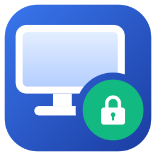

# safe-rdp

<p align="center"></p>

English | [한국어](README.ko.md)

A small, auditable remote desktop for use over Tailscale. Both **Windows and Linux** work as host and as viewer.

- **A single Rust executable** with no third-party crates. On Windows it uses only `windows-sys` (Microsoft's official Win32 bindings)
  and links the C runtime in, so no Visual C++ redistributable is needed;
  on Linux only the standard library plus the system OpenSSL (libcrypto), loaded with `dlopen` at run time (it does not link libX11/xcb either; it speaks the X11 protocol directly)
- Cryptography comes from the OS only (Windows CNG, Linux OpenSSL 3). The only hand-written crypto code is HKDF and the key fingerprint (a few HMAC calls)
- Screen data is **never written to disk** (no bitmap cache; frame buffers are locked in RAM and wiped on exit)

## Why — the bitmap cache in stock RDP

By default `mstsc.exe` turns on *persistent bitmap caching* and saves tiles of the remote screen to
`%LOCALAPPDATA%\Microsoft\Terminal Server Client\Cache\` (`bcache*.bmc`, `Cache*.bin`).
These files outlive the session, and public forensic tools can rebuild pieces of the remote screen from them.
safe-rdp is designed not to leave persistent data like this behind.

## Quick start (Windows, GUI)

1. Build: `cargo build --release` in the repository folder (with your own `RUSTFLAGS`, keep `-C target-feature=+crt-static`), then copy
   `target\release\safe-rdp.exe` to both PCs, into a folder only you or administrators can write and nothing is downloaded into:
   not Downloads or a shared folder, and not `Downloads\safe-rdp`, where received files go (run from there, safe-rdp refuses to
   receive files)
2. Double-click `safe-rdp.exe` to open the launcher window (same as `safe-rdp gui`)
3. **Key** tab: on one PC, *Create new key* → *Copy*; on the other PC, paste it under *Import* on the Key tab
   (the copied key is kept out of clipboard history and cloud sync, and is cleared automatically after 60 seconds).
   Replacing or removing the key there restarts (or stops) sharing from the launcher and disconnects anyone connected;
   while it is sharing, a key changed in a terminal (`keygen --force`, `key import`, `key forget`) is picked up within about 2 seconds
4. Remote PC: on the **Share this PC** tab, click *Start sharing*. Choose the features to allow (control, clipboard, files, sound, privacy screen;
   only control starts ticked)
5. Local PC: on the **Connect** tab, double-click the remote PC in the list of Tailscale devices. *Share clipboard* and *Play sound* are
   opt-in there, as on the command line (settings saved by earlier versions have both turned off once); *Quality* starts at *Default*,
   the host's choice

The **connection bar** at the top of the viewer window switches monitor, quality and scale, and handles the clipboard, sending/getting files,
sound, the privacy screen, full screen and disconnecting. In full screen it appears when you move the mouse to the top center of the screen.
Buttons for features the host does not allow are hidden, and a dropped connection is re-established automatically
(after 1, 2, 4, 8, 16, 30 seconds, giving up after 2 minutes; it stops at once if the key is wrong).
An automatic reconnect takes back only its own session: if another viewer is connected by then, the host turns it away
("another viewer is using this host") and the viewer stops. Connecting by hand still replaces whoever is connected.
This needs a viewer and a host of this version: with an older one on either end, an automatic reconnect replaces whoever
is connected, as before.

## Quick start (command line, Windows and Linux)

```bash
safe-rdp keygen                # create a key (printed once, stored for this account only)
safe-rdp key import            # on the other PC: paste at the prompt (never taken as a command-line argument)
safe-rdp host                  # remote PC: binds only to this PC's Tailscale IP (waits for Tailscale)
safe-rdp devices               # list tailnet devices
safe-rdp connect remote-pc     # MagicDNS name, Tailscale IP or host:port
```

| Shortcut (viewer) | Action |
|---|---|
| `Ctrl+Alt+Enter` | Toggle full screen |
| `Ctrl+Alt+End` | Send Ctrl+Alt+Del to the remote (Windows service mode + `--enable-sas`) |

In windowed mode the Win key, Alt+Tab, Alt+Esc and Ctrl+Esc stay local (the same as mstsc's default), together with the
Ctrl/Alt/Shift held for them, so Ctrl+Shift+Esc, Alt+Shift+Tab and Ctrl+Win+arrow keys work locally too (a Windows remote does
not see them as a lone Alt or Win press); in full screen every key goes to the remote while the viewer has the focus (when another
window takes it, the Linux viewer lets go of the keyboard until it is focused again; under a window manager, the pointer merely
resting on it does not count as focus). The Korean Han/Eng and Hanja keys are passed through to the remote IME, and AltGr is passed
as Right Alt, so the remote's keyboard layout decides what it types. Text that a program on the viewer PC types as Unicode
characters (some password managers' auto-type, the emoji panel, the touch keyboard) is not forwarded, since only key presses are
sent; use the clipboard for it.

## Linux

Requirements: the OpenSSL 3 runtime (`libssl3`, installed by default on Ubuntu/Debian/Fedora); for the host, X11 (XTEST, XFIXES, and MIT-SHM if available);
for sound, PipeWire's `pw-record`/`pw-play`. Supported: 64-bit x86_64, aarch64 (e.g. Raspberry Pi OS 64-bit) and riscv64, with glibc,
or with musl as a dynamically linked build (`-C target-feature=-crt-static`) using the system's libcrypto: a static musl build,
Rust's default there, cannot load libcrypto. Builds for other architectures (32-bit ARM and x86, x32, powerpc, mips, s390x,
loongarch) stop with a compile error until their system constants have been checked.

- **Linux with a desktop**: run `safe-rdp host` in an X11 session. A Wayland session (Ubuntu's default GNOME) only lets it capture and
  control Xwayland windows, so pick "Ubuntu on Xorg" on the login screen or use a virtual display (below).
- **Server (no monitor)**: create a virtual display and share the program running inside it.

  ```bash
  safe-rdp host --virtual 1920x1080                      # default: a terminal that fills the screen
  safe-rdp host --virtual 1600x900 --session "xterm"     # a program of your choice
  ```

  Xvfb is started with TCP disabled and a random cookie, which Xvfb and the host read from an in-memory file without a name
  (handed to Xvfb as a file descriptor), so nothing done to a file path (a tmp cleaner, another user re-creating a directory) can
  remove or replace it; start-up fails if Xvfb lets a client in without the cookie. Programs in the session get a 0600 copy in a
  0700 directory under `$XDG_RUNTIME_DIR` (if it is the user's own and private), otherwise under the temporary directory, where
  the host keeps it locked against tmp cleaners while it runs. When the host ends (Ctrl+C, SIGTERM or an abnormal exit) Xvfb and the session end with it.
  Conversely, when the session program ends (`exit` in the terminal) the host stops too. So do not start the `--session`
  command in the background; keep it running in the foreground (`exec program`).
  To keep other users on the same server from hijacking the virtual display, every connection checks with `SO_PEERCRED`
  that the X server is the Xvfb process we started, and the owner of `/tmp/.X11-unix` is checked as well.
- **Viewer**: `safe-rdp connect` opens an X11 window (there is no connection bar; use the shortcuts and command-line options).
  It does not reconnect by itself, and X11 cannot keep its window out of screenshots or recordings (it warns at start).
- The key is stored in `~/.config/safe-rdp/key` (directory 0700, file 0600). There is no OS encryption like Windows DPAPI,
  so disk encryption is recommended.

Linux hosts have no privacy screen, no Ctrl+Alt+Del and no "Get copied files" (uploads work).

## Features

| Feature | Description |
|---|---|
| Quality | `Balanced` (the host's default unless it was started with `--quality`): only complex tiles such as photos and video are compressed lossily (JPEG-style, q80); text and UI stay lossless, and a lossy tile is resent losslessly once it has stayed unchanged for 0.3 s, even while other parts of the screen keep changing. `Low bandwidth`: q50, corrected after 1.5 s. `Lossless` (switching to it makes lossy tiles exact right away) |
| Scale | 100/50/33/25% (`--downscale`), for viewing a 4K host on a laptop or over a slow link |
| Monitor | Switch monitors during a session; `all` shows every monitor as one screen (DXGI, multiple GPUs included). Rotated and HDR monitors are supported |
| Clipboard | Text; works only when both sides turn it on. Text from the remote is kept out of Win+V history and the cloud clipboard |
| Files | Drop files on the viewer window or use *Send files* → `Downloads\safe-rdp` on the host. *Get copied files*: files copied (Ctrl+C) in Explorer on the host go to `Downloads\safe-rdp` on the viewer |
| Sound | The host's system sound (WASAPI loopback / PipeWire), IMA ADPCM at about 390 kbit/s, about 90–130 ms latency |
| Privacy screen | Blacks out the host monitor and blocks the host's local keyboard and mouse during remote use (Windows hosts) |

File transfer safeguards:
- Only a single file name is accepted, never a path. Names ending in `.` or a space, device names such as `CON` and `NUL`, and
  bidirectional characters (RLO etc.) that disguise the extension are rejected
- Files are received into a randomly named `.srdp-*.part` file (hidden by its leading dot on Linux; on Windows it is visible, but
  other programs cannot write to or delete it meanwhile) and given their real name only if the size and SHA-256 match. Existing
  files are never overwritten (`name (1).ext`)
- On Windows the *downloaded from the internet* mark (Mark of the Web) is attached as soon as receiving starts, so SmartScreen and
  Office Protected View apply. Transfers are refused on drives that cannot carry the mark (FAT/exFAT)
- The viewer accepts files only after you click *Get copied files* (at most 1000 per click; the request expires if the transfer
  stalls for more than 30 seconds, and you are told if files arrived after it expired). Copied files on network paths
  (`\\server\...` or a mapped network drive) are never sent
- A received file must leave 1% of its volume free (256 MiB to 2 GiB; 5% in the service's own folder, see below), counting other
  transfers still arriving; this is checked again every 64 MiB, and a transfer stops if the disk fills up meanwhile. An abandoned
  partial file is deleted (on Windows through its open handle, never by its path)
- Received files are never saved into the folder safe-rdp itself runs from (where Windows looks for DLLs first): that transfer is
  refused with a message saying to move safe-rdp.exe elsewhere
- In service mode, *Get copied files* and uploads to a `--transfer-dir` folder use the rights of the user signed in on the console
  rather than SYSTEM's, so neither works on the sign-in screen (see Service mode for the default upload folder)

The privacy screen lets through only input sent by the viewer (each event carries a random marker that is used only once). Markers that another
program saw before the privacy screen was turned on are invalid, and only one privacy screen can be on at a time per host process.
Keys that Windows adds to the viewer's own input (the Left Ctrl of AltGr on layouts that have it, and with Num Lock on the Shift
released and pressed again around a numpad key) pass only while the host is injecting that key, so AltGr and Shift+numpad work as usual.
Limits: Windows always handles Ctrl+Alt+Del and Win+L itself, so the person at the remote PC can lock it at any time.
The secure desktop (UAC, lock screen) and shell surfaces such as the Start menu and notifications can appear above the cover,
and the mouse pointer stays visible. While an elevated window has focus, a host running with normal rights cannot block local input.

## Service mode (Windows: lock screen / sign-in screen / UAC)

`safe-rdp host` runs with normal rights inside the signed-in user's session, so it cannot reach
the lock screen, the UAC secure desktop or elevated windows. If you need those, install it as a service
(with the button at the bottom of the launcher's *Share this PC* tab, or from an elevated terminal):

```bash
safe-rdp service install --enable-sas
safe-rdp service status        # state, and the service key's fingerprint: whether it is this user's key
safe-rdp service rekey         # give the service this account's current key; other options stay
safe-rdp service uninstall
```

What installation does:

1. Copies the executable to `C:\Program Files\safe-rdp\` (so it runs as SYSTEM from a location only administrators can modify)
2. Stores the key in `%ProgramData%\safe-rdp\service.key` — folder/file ACLs allow only SYSTEM and Administrators, and the contents are encrypted with DPAPI (machine scope)
3. Registers the `SafeRdpHost` service (automatic start, restart on failure) and records the key's fingerprint at
   `HKLM\SYSTEM\CurrentControlSet\Services\SafeRdpHost\Parameters\KeyFingerprint` (users can read it, only administrators can change it,
   and it goes with the service)
4. Firewall: allows inbound TCP 47300 (or the port given with `--port`) for this program **only from remote IPs in 100.64.0.0/10 and fd7a:115c:a1e0::/48**
   (`netsh.exe` is run from System32 by its full path)
5. Sets the `SoftwareSASGeneration=1` policy only if `--enable-sas` is given (so that the service can generate Ctrl+Alt+Del)

The service keeps the key it was installed with, and accepts it until told otherwise. After changing your key (`keygen --force`,
`key import`, the Key tab), run `safe-rdp service rekey` elevated: it gives the service the key stored for the account that runs it and
restarts it, keeping its command line, firewall rule and options; after `key forget`, run `service uninstall`. The key commands and
`service status` say which key the service has and print the exact command. A service without a recorded fingerprint may have been
installed by an earlier safe-rdp and then still runs that earlier program, which `rekey` leaves in place: for it they suggest
`service install --expect-key <fingerprint>` with the options it was installed with, and `rekey` adds a note saying so.
The launcher offers the update right after the change, and meanwhile shows *Update key* (rekey) on its install button while the
service is known to have another key. A service whose key is unknown is marked *key unknown* (the *Share this PC* tab says why)
and keeps *Reinstall*, which the offer after a key change runs as well (*Reinstall* warns that options set in a terminal are
dropped). Given `--expect-key <fingerprint>` as their first argument, `install` and `rekey` refuse (exit code 3, nothing changed)
unless the running account's key has that fingerprint. The launcher always passes it: under UAC the service gets the key of the
account that approves the prompt. Both also replace nothing when the installed service does not stop within 20 s (exit code 4),
and exit with code 5 when the service got the new key and its fingerprint but could not be started.

`%ProgramData%\safe-rdp` must be owned by SYSTEM/Administrators and have an administrators-only ACL. If a normal user created the
folder beforehand, installation is refused (to prevent key theft or substitution); delete that folder and install again. The service
and the agent run the same check every time they start, and before ending the agent the service first asks it to shut down cleanly
(releasing held keys) through a SYSTEM-only event.
The "Continue" button Explorer shows when you open this folder only adds read access, so it is harmless, but if another account is
given write access the service refuses to start. In that case `safe-rdp service status` shows why, and running `service install`
again restores the permissions.
With `--files` and no `--transfer-dir`, the service saves uploads to `%ProgramData%\safe-rdp\incoming` (administrators only), also at
the sign-in and lock screens. That folder takes at most 1000 files / 64 GiB in all until an administrator empties it, and a file is
accepted there only if its volume keeps 5% free (1 to 16 GiB). With `--transfer-dir <full path>` (`service install` refuses a relative
one) uploads are saved as the user signed in on the console: only while someone is signed in, and only if that user can create files
in the folder. *Get copied files* always needs a signed-in user. The service (session 0) starts an *agent* with a SYSTEM token in the active console session,
and the agent follows the input desktop (Default ↔ Winlogon) to capture the screen and inject input.
Logs: `%ProgramData%\safe-rdp\service.log`, `host.log` (only IPs and events are logged, never screen contents, keystrokes or file
contents; a log over 4 MiB is moved to `.old` and a new one is started, so logs cannot fill the disk)

## Options

```
Host (host / service install):
  --bind <ip>              Bind address (default: this PC's Tailscale IPv4, waiting until there is one)
  --port <n>               TCP port (default 47300)
  --allow <ip>[,<ip>...]   Accept only these addresses (default: all Tailscale peers)
  --allow-non-tailscale    Allow binding/peers outside the Tailscale ranges (not recommended)
  --monitor <n|all>        Monitor shown first (1 = primary, the default; see `safe-rdp monitors`);
                           viewers can switch to any monitor of this PC
  --fps <n>                Frame rate cap (default 30)
  --quality <q>            Default for viewers that do not set a quality: lossless | balanced | low
  --clipboard              Allow text clipboard sharing (the viewer must turn it on too)
  --files                  Allow file transfer (uploads, getting copied files)
  --transfer-dir <path>    Where uploads are saved (service: a full path; uploads are saved there as the user
                           signed in on the console)
  --audio                  Allow viewers to hear this PC's sound
  --privacy                Allow viewers to blank this PC's screen and block its local input
  --view-only              Ignore keyboard/mouse input (files and the privacy screen are not available either)
  --virtual <WxH>          (Linux) Run in a new virtual X display (Xvfb)
  --session <cmd>          (Linux, with --virtual) Program to run in it
  --key-file <path>        Read the key from a text file instead of the key store (not with service install)

Viewer (connect):
  --fullscreen             Start in full screen
  --clipboard              Share the text clipboard (the host must allow it too)
  --view-only              Do not send input
  --downscale <2|3|4>      Receive at 1/N resolution
  --quality <q>            lossless | balanced | low (default: the host's --quality, else balanced)
  --monitor <n|all>        Host monitor to view (1 = primary)
  --audio                  Play the host's sound
  --privacy                Blank the host's screen and block its local input while connected
  --allow-capture          (Windows) Let local capture tools capture the viewer window (blocked by default;
                           the Linux/X11 viewer cannot block it)
  --key-file <path>        Read the key from a text file
```

Clipboard, files, sound and the privacy screen are all enabled only **if the host explicitly allows them** (off by default);
the viewer's clipboard and sound are opt-in as well.
Other commands: `safe-rdp monitors`, `safe-rdp bench` (capture/encode speed), `safe-rdp key show|forget`,
`safe-rdp probe` (a diagnostic tool that connects without a screen and tests latency, bandwidth, input, settings and file transfer).
After `keygen --force`, `key import` or `key forget`, a `safe-rdp host` that is already running keeps the old key until it is restarted.

## Security design

### Transport layer (one more layer on top of Tailscale encryption)

Tailscale (WireGuard) already encrypts the traffic, but to guard against other devices on the same tailnet, ACL mistakes or a
hijacked Tailscale account, safe-rdp **authenticates and encrypts independently at the application layer**.

```
C -> S  ClientHello = "SRDP" | ver(2) | nonce_c[32] | ECDH_P256_pub_c[64]
S -> C  ServerHello = "SRDP" | ver(2) | nonce_s[32] | ECDH_P256_pub_s[64] | server_confirm[32]
C -> S  client_confirm[32]

th  = SHA-256("safe-rdp/2 transcript" | ClientHello | ServerHello(without confirm))
prk = HKDF-Extract(salt = PSK, ikm = ECDH shared secret (X coordinate, big-endian))
okm = HKDF-Expand(prk, "safe-rdp/2 keys" | th, 128)
    = key_c2s | key_s2c | server_confirm | client_confirm
```

- **Mutual authentication**: the confirm values cannot be computed without the 256-bit random PSK. The server proves itself first,
  so the client reveals nothing to a fake server.
- **Forward secrecy**: ephemeral ECDH keys for every session. Even if the PSK leaks later, recorded past traffic cannot be decrypted.
- **No offline dictionary attacks**: the key is not a password; only 32-byte random keys made by `keygen` are accepted.
- **Key fingerprint**: the only key-derived value stored outside the key stores (for the service, see above) is the first 8 bytes of
  HMAC-SHA256(key, "safe-rdp/1 key fingerprint"). It reveals nothing about the 256-bit key, and that label can never equal the
  32-byte ECDH secret the handshake feeds to HMAC under the same key.
- **Records**: AES-256-GCM, one key per direction, 64-bit counter nonces (replay, reordering or tampering ends the session at once),
  the length field is authenticated as AAD too, records are at most 32 MiB.
- NIST CAVS vectors and fixed AES-GCM vectors, run on both platforms, check that Windows (CNG) and Linux (OpenSSL) produce the same bytes.

### Minimal attack surface

- Binds only to the Tailscale interface: by default to an address on Tailscale's own adapter (Windows: the *Tailscale Tunnel*
  adapter; Linux: `tailscale0`) or one that `tailscale status` reports as this device's. An address that is merely in 100.64.0.0/10
  (carrier-grade NAT from a mobile modem or a 5G/satellite gateway, another VPN) is ignored and logged once, and the host keeps
  waiting for Tailscale. A peer whose address is outside the Tailscale ranges is dropped before the handshake
- On Windows, safe-rdp.exe imports at start-up only DLLs that Windows maps, with what they import, from its own copies
  (KnownDLLs); every other DLL it uses is loaded on first use and looked for in System32 only. So a `dxgi.dll` or `sspicli.dll`
  lying beside it (in Downloads, a shared folder, among received files) is not loaded. Windows' side-by-side mechanism is the
  exception: a `safe-rdp.exe.config` and an assembly manifest placed beside it can still redirect the common controls it asks for,
  and through them make Windows load any DLL from that folder. So keep safe-rdp.exe where only you or administrators can write
- The only parsing before authentication is one fixed-length 101-byte message. The handshake and the viewer's first message (its
  hello, at most 13 bytes) share one 10-second deadline from accept (a peer cannot hang on by trickling one byte at a time), and
  until a viewer is let in or turned away, concurrent connections are capped at 8 in total, 2 per address and
  (for IPv6 outside Tailscale) 4 per /64, failed addresses get a 1-second delay, and logging before authentication is limited to a few
  lines per minute
- After authentication, every message, tile coordinate and decompressed size is still validated (a single message that would draw more
  than twice the screen area is rejected too). All decompression (XPRESS Huffman, the lossy codec, ADPCM) is implemented in
  memory-safe Rust and fuzz-tested with tens of thousands of malformed inputs. Setting changes (quality, scale, monitor) wait at most
  16 deep on the host; a viewer that sends more waits, so it cannot grow host memory or hold up the screen updates
- Names and notification text from the peer have control and bidirectional characters filtered out before they are shown or logged.
  Even a malicious host cannot turn on the viewer's sound or privacy screen behind the user's back, send files that were not
  requested, or freeze the viewer with a flood of notifications, frames, cursor changes or setting changes
- Nor can a host run a viewer out of memory or keep its window busy: only the newest frame acknowledgement waits to be sent; a host
  that stops reading while 4096 messages or 8 MiB of clipboard text wait ends the session (the Windows viewer reconnects), and as a
  new clipboard text replaces one still waiting unless a key or click was queued after it, copying again and again over a slow
  link never reaches that cap; tiles are decoded outside the lock the window needs, and over 480 screens' worth per second (beyond a
  1-second burst) ends the session; size changes are paced (8 back to back, then one per second); merged frame and cursor wakeups
  let input and repaints in between; one paint of the Windows viewer smooths at most about a whole 4K frame (a larger picture is
  shown unsmoothed while it moves and smoothed about 150 ms after it stops), so no host makes a paint cost more than a 4K screen
- A view-only session cannot send input, and it cannot change the host clipboard, transfer files or use the privacy screen either
- When a new viewer authenticates, the existing session is replaced (one session at a time). The replaced viewer is told why
  ("another viewer connected to this host") and does not reconnect; the host keeps its connection open until it has read that
  notice (up to 20 s, at most 4 such connections at once), without making the newcomer wait
- On disconnect all held keys and buttons are released and the privacy screen is turned off. On a Windows host, releases that
  cannot reach the input desktop (a plain host at the lock screen or a UAC prompt) are retried every 0.5 s, during the session
  and for up to 10 minutes after it; the next session takes over any still owed and keeps retrying them for as long as it lasts,
  whether or not its viewer sends input. A host that stops while they are still owed cannot release them
- Stopping the host with Ctrl+C/SIGTERM goes through the same cleanup

### No leftover screen data

| Risk | Mitigation |
|---|---|
| On-disk bitmap cache | None. There is no code that writes screen data to files at all (except the diagnostic `probe --snapshot`) |
| Swap | Frame buffers are locked in RAM with `VirtualLock`/`mlock`; on Linux they are also excluded from core dumps. The viewer's session reader decodes into a locked copy of its own, so the viewer holds about twice the remote screen (at most 2 × 256 MiB; while the remote screen changes size, the Linux viewer briefly holds a third copy) |
| Memory left after exit | Frame buffers, plaintext record buffers and keys are overwritten with zeros before they are freed |
| Other processes reading memory | Linux: `PR_SET_DUMPABLE=0` (blocks ptrace and /proc/pid/mem from the same user) |
| Local screenshots/recording | Windows: `WDA_EXCLUDEFROMCAPTURE` on the viewer window (it shows as black in captures; lift with `--allow-capture`). Linux (X11): not possible; the viewer warns when it starts |
| Key storage | Windows: DPAPI (user scope); the service uses ACLs + DPAPI (machine scope). Linux: 0600 file |

## Layout

```
src/
  main.rs         command line
  channel.rs      handshake + encrypted record layer        proto.rs   message definitions (v2)
  crypto/         cng.rs (Windows) / openssl.rs (Linux, dlopen) + HKDF
  codec/          64x64 tile diff, left-prediction filter
    xpress.rs     [MS-XCA] XPRESS Huffman compression/decompression (pure Rust, interop verified with cabinet.dll)
    lossy.rs      lossy tiles (YCbCr 4:2:0, DCT, fixed Huffman; cross-checked with ffmpeg)
  host.rs         host: listener, sessions (capture, receiving and input threads), takeover, flow control, settings, files, sound
  viewer.rs       shared viewer code: connecting, send queue, decoding and framebuffer lock, resize pacing, reconnect policy
  audio.rs        IMA ADPCM, 20 ms packets
  files.rs        file send/receive (atomic, checksummed, no overwrites)
  tailscale.rs    device list from `tailscale status --json`     json.rs  strict JSON parser
  probe.rs        headless diagnostic client
  platform/
    windows/      dxgi (multiple outputs, rotation, HDR, dirty rects), capture (GDI fallback), input, clipboard, desktop,
                  privacy (cover, input blocking), audio (WASAPI), service, keystore (DPAPI),
                  viewer + toolbar (connection bar), launcher (GUI)
    linux/        x11 (X11 protocol spoken directly over the socket), capture (MIT-SHM), input (XTEST), clipboard, keymap,
                  viewer, xvfb (virtual display), audio (PipeWire), keystore
```

Flow control: while two or more frames are unacknowledged, the host does not produce the next frame and
waits instead. On a slow link the frame rate simply drops rather than latency building up,
and the next frame is always the latest screen.

Performance (example measurement: desktop PC, 3840x2160 display): DXGI copies only the changed regions (0.5–6 ms per update),
encoding a full 4K frame takes 54 ms / 955 KiB (about 25 times smaller than raw 24-bit), decoding 36 ms.
While the screen is still, host CPU use is close to zero. Linux Xvfb 1080p capture (MIT-SHM) takes 0.2 ms.

## Limitations (know these before you use it)

- It **mirrors the console session**. Unlike RDP it does not create a separate session, so the remote PC's monitor shows
  the same screen → a Windows host can hide it with the *privacy screen* (`--privacy`).
- When the whole screen moves, as in scrolling, there is no move detection, so every changed tile is sent again
  (about 35 Mbit/s for terminal scrolling at 1600x900). On slow links use `--downscale 2` or `Low bandwidth`.
- There is no printer/drive redirection, no microphone and no support for multiple simultaneous viewers.
- Plain `host` mode cannot operate the lock screen, UAC or elevated windows → use service mode.
  Ctrl+Alt+Del works only in service mode with `--enable-sas` (Windows policy offers no other way).
- Memory protection is *best effort*. It does not cover the hibernation file (hiberfil.sys), GPU memory or kernel crash dumps.
  Use full-disk encryption (BitLocker/LUKS) as well.
- The Linux (X11) viewer cannot keep its window out of screenshots, recordings or screen sharing on its own display.
- Unicode text typed by other programs is not forwarded (see the keyboard notes). On a Linux remote, a local Alt+Tab from a
  windowed viewer can still arrive as a lone Alt press (Firefox may show its menu bar).
- Older and newer versions work together: hosts accept every hello, and every viewer first sends the original 5-byte one. Only a
  host of this version, which announces that it knows viewer instances, is told the Windows viewer's random 8-byte instance id
  (in a message right after the hellos, or in the hello of an automatic reconnect). Older hosts get the 5-byte hello, reconnects
  included, and take it as before, replacing whoever is connected, so the reconnect rule above needs a host of this version. Only
  if a host is downgraded while a viewer is reconnecting does the first attempt replace that host's viewer and fail ("the host
  closed the connection without answering the hello"); later attempts leave the instance out.
- Limiting which devices can reach port 47300 with Tailscale ACLs adds one more layer of safety.

## Test status

- Independent review: the 40 issues found by per-area reviewers were checked by other agents that tried to refute them, then fixed;
  the fixed code was attacked again and the remaining issues were fixed in two more rounds; finally a new reviewer re-examined all
  the fixes for regressions, and the 6 issues found there were fixed as well. A later full review found 25 more medium-severity
  issues; they were fixed, the fixes were verified separately, and what that verification found was fixed in a further round
- Unit and integration tests: 289 on Windows, 213 on Linux + 18 integration tests that need Xvfb or PipeWire (`cargo test -- --ignored`)
  - Crypto: SHA-256, HMAC (RFC 4231), HKDF (RFC 5869), AES-GCM (NIST), ECDH (NIST CAVS), fixed CNG↔OpenSSL byte vectors
  - Codec: [MS-XCA] spec examples, cabinet.dll golden streams and cross-decoding, fuzzing with 30,000 malformed streams, lossy codec PSNR and ffmpeg cross-checks
  - Host sessions end to end (settings, files, flow control, session replacement and reconnects), viewer reconnect policy and flood limits, launcher command line, JSON/Tailscale parsing
- Cross-machine tests (Windows 11 PC ↔ Ubuntu 24.04 server, Tailscale):
  - Windows viewer/probe → Linux virtual display host: handshake 28–84 ms, 30 fps, input, files (3 MiB, SHA-256 match), settings and sound packets verified
  - Linux probe and X11 viewer → Windows host (DXGI): all three quality modes, scaling, monitor switching, view-only policy rejections,
    uploads (SHA-256 match, Mark of the Web verified), and an attack that drags out the handshake one byte at a time being cut off at the deadline
  - Linux virtual display host: when the session program ends, the host stops and no Xvfb process or cookie is left behind
- **Not tried for real yet**: service mode (needs administrator rights), turning the privacy screen on with a real monitor,
  listening to the sound, multiple monitors and HDR displays, a host on a real GNOME/Xorg desktop.

## License

MIT ([LICENSE](LICENSE))
